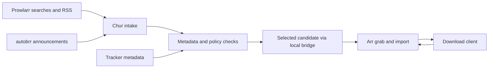

# Chur

A self-hosted companion for Sonarr and Radarr that selects releases for missing media and upgrades using clear, customisable policies. Arr continues managing the library, download clients, naming, and imports.

**Status:** foundation implemented. Account setup, authentication, SQLite migrations, durable jobs, and backup/restore are available. Media-service connections and download automation are not implemented yet. Earlier bridge tests verified initial downloads and a higher-quality Radarr replacement.

## Run locally

Requires Node 24.15+ (v24) or v26+ and pnpm 12.14.0.

```sh
pnpm install --frozen-lockfile
cp .env.example .env.local
pnpm dev
```

Run `pnpm setup:token` in another terminal to retrieve the initial setup token, then create your account in the browser. See [development and recovery](docs/development.md) for checks and backups.

## Why Chur?

Release selection should reflect the user's preferences, with enough evidence to explain each decision.

- Enrich incomplete filenames with tracker metadata and MediaInfo where available.
- Protect deliberately selected releases while still suggesting improvements.
- Replace Custom Format maintenance with readable requirements and preferences.
- Search periodically and reconsider the library when a new tracker is added.
- Compare repairs in the context of their release group and revision.
- Check episode numbering, season-pack completeness, and edition identity.

## Agreed behaviour

- Reuse Arr's allowed qualities, quality groups, and profiles. Respect quality ordering by default, with explicit preference overrides.
- Do not use Arr Custom Format scores for Chur's decisions or delete existing formats.
- Complete policy checks and required approvals **before downloading**. Keep missing evidence visible and block ambiguous media identity.
- Start in dry-run mode. Once automation is enabled, downloads and upgrades proceed automatically unless a title or policy requires approval.
- Keep dismissed suggestions dismissed until the candidate, evidence, or policy changes.
- Own RSS, autobrr intake, and manual/scheduled searches, with a whole-instance handover that prevents competing Arr grabs.
- Follow applicable [TRaSH Guides](https://trash-guides.info/), with documented, previewable preset updates.

## How it fits



Chur connects directly to Prowlarr and Arr. The bridge supplies an already selected candidate to Arr's interactive cache, allowing an explicit grab without another tracker search. Missing MediaInfo may still require a separate tracker request; those requests are cached and rate-limited.

## Stack and scope

**Nuxt + SQLite**, with TypeScript, a persistent background worker, and one Docker container. SQLite stores operational records and JSON metadata on `data/` locally, mounted at `/app/data` in Docker.

The first release targets Radarr: missing films, upgrades, policy editing, explanations, approval, discovery, and handover. Sonarr follows, prioritising wrong episode numbering and incomplete packs. Edition changes are protected; retaining multiple editions simultaneously is deferred.

## Documentation

- [Development and recovery](docs/development.md)
- [Implementation plan](docs/implementation-plan.md)
- [Integration findings and validation](docs/arr-source-investigation.md)

## Contributing

Use pull requests for changes; CI checks Node 24 and 26. Report bugs and suggest features through the issue templates. See [SECURITY.md](SECURITY.md) for private vulnerability reports. Licensed under [GPL-3.0](LICENSE).
