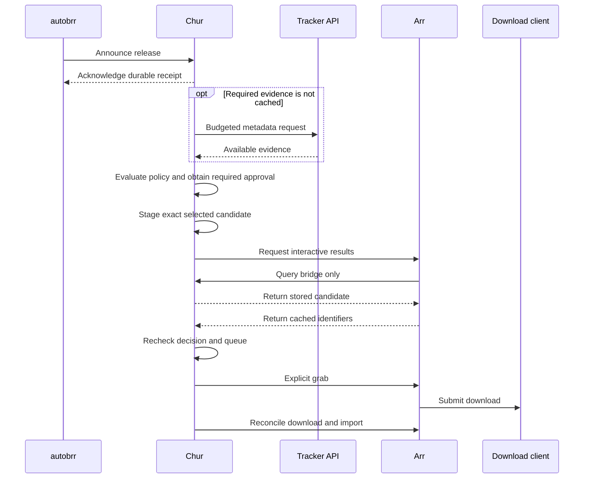

# Integration findings

Source review and runtime checks, completed 1 November 2026. **Chosen route:** Chur stages a candidate through its local indexer bridge, then invokes Arr's explicit grab. Arr retains download-client and library file handling.

## Verified behaviour

Runtime checks used Radarr **6.4.4.10685**, qBittorrent, and existing Prowlarr-connected trackers.

| Check | Result |
| --- | --- |
| Pre-download enrichment | Tracker APIs supplied MediaInfo absent from Prowlarr's normalised search response. Imported audio metadata matched the posted reports in the tested acquisitions. |
| Cache-only bridge | Radarr returned exactly the staged candidate with a Chur GUID, even when its normal selection rules rejected it. No download was needed. |
| Initial acquisition | An independently discovered Prowlarr candidate passed through bridge, explicit grab, download, and automatic import. |
| Replacement | A WEB-DL replaced an existing HDTV file despite a release-selection Custom Format score of `-10000`. New file and deletion/import history confirmed replacement. |
| Cleanup | Original indexer flags were restored, the temporary bridge was disabled, and staging cleared. Profiles and Custom Formats were unchanged. |

Same-quality replacements with lower scores, quality downgrades, and explicit import overrides remain unverified. These are documented compatibility limits, not blockers for application development. Sonarr, Usenet, autobrr delivery, and whole-instance handover have not been runtime-validated.

## Arr contract

- **Release-push is not a trusted override.** It runs Arr's decision engine; adding `approved` or `shouldOverride` does not bypass it.
- **Explicit grab requires a cached candidate.** Interactive results are cached for 30 minutes in the inspected versions. Chur stages the exact release locally, asks Arr to query the bridge, then submits its cached identifiers.
- **Import is a separate boundary.** Automatic import can reject lower qualities, revisions, or same-quality Custom Format scores. A successful grab does not guarantee import.
- **Manual import is an execution option to validate.** The command bypasses automatic specification rejections, so Chur must not indiscriminately force blocked files. Operational and filesystem failures still apply.

Keep truthful quality and identity metadata. If explicit import orchestration becomes necessary, it executes the pre-download decision; it does not introduce post-download preference checks.

## autobrr flow

The bridge exchange makes no second tracker search. Enrichment and torrent/NZB retrieval may still contact trackers. Cache evidence, coalesce duplicate requests, and apply per-tracker budgets/backoff. Direct enrichment bypasses Prowlarr's request accounting; allow for other applications' traffic too.

autobrr's inspected ordinary webhook action does not check HTTP response status. Prefer its external-filter webhook with an expected acknowledgement status, bounded retries, and a non-downloading action. Receipt means stored for evaluation, not approved. Remove competing direct download actions and filter fall-through.

## Handover requirements

- Disable ordinary Arr indexers' RSS, automatic search, and interactive search. Enable only the bridge's interactive search.
- Disable `autoRedownloadFailed`; Chur owns replacement selection after failure.
- Reconcile running searches, active downloads, and persisted delayed releases. RSS sync also processes delayed candidates without fresh results.
- Prevent Prowlarr synchronisation or new indexers from restoring competing flags. Search flags are not API access controls.
- Snapshot settings, verify activation, detect drift, and restore only scoped changes. Preserve monitoring intent and Custom Formats.

The tested registration path creates a fully disabled Torznab indexer, then toggles interactive search through `PUT /api/v3/indexer/bulk`. Normal connection tests expect a non-empty recent feed and therefore reject this intentionally empty broad feed. Arr's movie-search API queries **all** eligible interactive indexers, so bridge-only traffic requires isolating those flags.

## Metadata and identity

Chur needs a direct Prowlarr connection. Tracker-specific enrichment may need separate credentials; access through Prowlarr varies by implementation. Posted reports are evidence, not independently verified file contents. A file count does not prove episode coverage.

One inspection found a movie entry mapped to a 42-minute series episode. Pilot numbering and runtime conflicts also appeared across sources. Match identity explicitly before downloading. For Sonarr, account for every episode in a displaced multi-episode file: Arr can remove the whole file when replacing one mapped episode.

## Source baseline

| Project | Inspected release and commit |
| --- | --- |
| Radarr | [6.4.4.10685 · a96bf7c](https://github.com/Radarr/Radarr/tree/a96bf7c3ecb23cb76993770727285dc17a613fbc) |
| Sonarr | [4.0.20.3014 · cab419a](https://github.com/Sonarr/Sonarr/tree/cab419ade8ac7fcab5bf80394ee492abd35d5f5a) |
| Prowlarr | [2.7.0.5723 · 0dc20d8](https://github.com/Prowlarr/Prowlarr/tree/0dc20d8495bad9951c3fafe53f32b6e1c70fcf3b) |
| autobrr | [1.89.0 · aae51db](https://github.com/autobrr/autobrr/tree/aae51db481267448276b483c9dd6f1f72d91ac33) |

Key references: [grab/cache](https://github.com/Radarr/Radarr/blob/a96bf7c3ecb23cb76993770727285dc17a613fbc/src/Radarr.Api.V3/Indexers/ReleaseController.cs), [push](https://github.com/Radarr/Radarr/blob/a96bf7c3ecb23cb76993770727285dc17a613fbc/src/Radarr.Api.V3/Indexers/ReleasePushController.cs), [automatic import checks](https://github.com/Radarr/Radarr/blob/a96bf7c3ecb23cb76993770727285dc17a613fbc/src/NzbDrone.Core/MediaFiles/MovieImport/Specifications/UpgradeSpecification.cs), [manual import](https://github.com/Radarr/Radarr/blob/a96bf7c3ecb23cb76993770727285dc17a613fbc/src/NzbDrone.Core/MediaFiles/MovieImport/Manual/ManualImportService.cs), [Prowlarr response](https://github.com/Prowlarr/Prowlarr/blob/0dc20d8495bad9951c3fafe53f32b6e1c70fcf3b/src/Prowlarr.Api.V1/Search/ReleaseResource.cs), [autobrr webhook handling](https://github.com/autobrr/autobrr/blob/aae51db481267448276b483c9dd6f1f72d91ac33/internal/filter/service.go).
